# LibanPost eShop — Forms in Pictures

A screenshot walkthrough of the demo shop: every page that contains a form, with the forms
and their fields explained. Pair it with **Pages and Forms Reference**
(`PAGES_AND_FORMS.md`), which documents every field and its server-side validation rules in
table form.

Everything below was captured from a running demo seeded with the standard seed data
(admin `admin@libanpost.example`, one shop "LibanPost eShop", 18 products, three coupons,
one tax class). Screens differ slightly from your instance if settings change (theme,
email transport, payment provider).

---

## Part 1 — Browsing the store

### Home — `/`

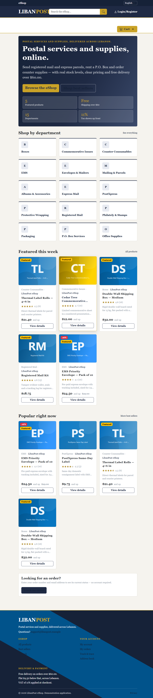

Not a form page — it is the storefront landing: hero, search box (top bar), department
menu, featured products and best sellers. The **search** box in the banner is the one
form element; submitting it goes to `/Catalog?q=…` and drives the server-side autocomplete
at `/Catalog/Suggest`.

### Catalogue — `/Catalog`

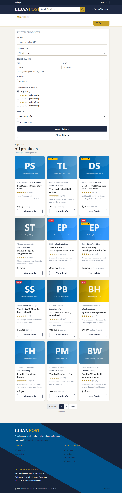

The left panel is the catalogue **filter form** (a GET form — filters become URL query
parameters and can be bookmarked):

- **Search** — free text, matched against product name, brand and SKU.
- **Department / Category** — links that pre-select `?category=…`.
- **Price min / max** — numeric range; anything non-numeric is ignored.
- **Sort** — dropdown (newest, price low→high, price high→low, best sellers…).
- **Filter** applies; **Reset** returns to the plain listing.

Product cards expose an **Add** button (a POST form that adds the first default variant to
the cart), the price band "from …", stock hint, and a ratings line.

### Product details — `/product/{slug}`

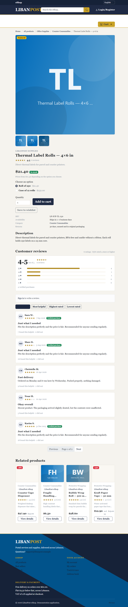

The richest storefront page. Forms on it:

- **Choose an option** — one **radio** per variant (each shows its own price, e.g. *Roll
  of 250 — $21.40*). A variant must be picked before "Add to cart" works; the server
  rejects an unselected or inactive variant.
- **Quantity** — a number input; invalid or huge quantities are re-checked on the server.
- **Add to cart** — POST; a successful add either bounces to the cart or shows the updated
  cart badge.
- **Save to wishlist** — separate POST form; only works while signed in.
- The meta row shows **SKU, availability, delivery estimate, returns** — all server
  computed, not editable.
- **Customer reviews** — for reviews you own, **Delete** buttons appear; for every review,
  **Helpful (n) / Not helpful (n)** are per-customer POST votes.
- The write-a-review form only appears if you have bought and received the item.

### Shops directory — `/Shops`

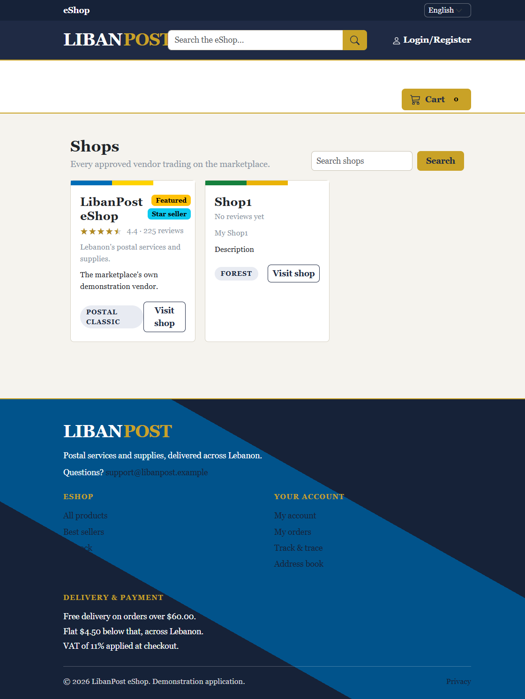

A search box (GET) over shop names plus one card per approved shop. Each card links to the
shop storefront.

### A shop's storefront — `/shop/{slug}`

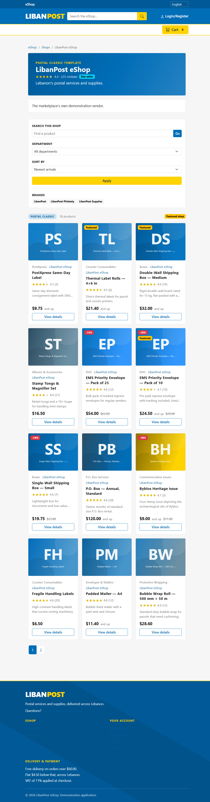

The same catalogue view, but scoped to one shop and coloured by that shop's template
theme. Filter/search forms behave exactly like the catalogue. Note the shop policy column
(shipping rate, free-shipping threshold, commission is *not* shown to shoppers).

### Page not found (the fallback)

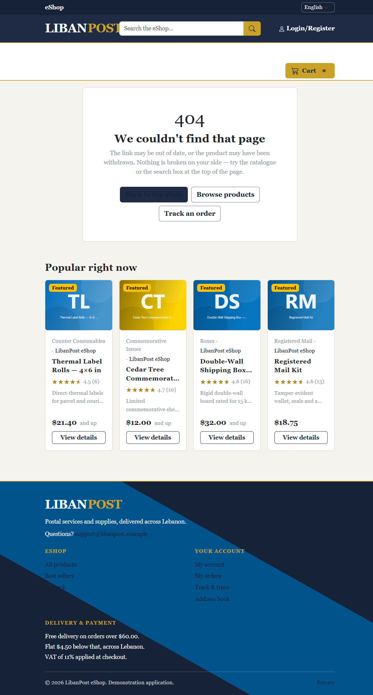

Whatever breaks — a retired product slug, a mistyped order number — lands here with links
back to the store and the catalogue. No forms; useful to confirm your 404 handling is
custom and friendly.

---

## Part 2 — Buying

### Your cart — `/Cart`

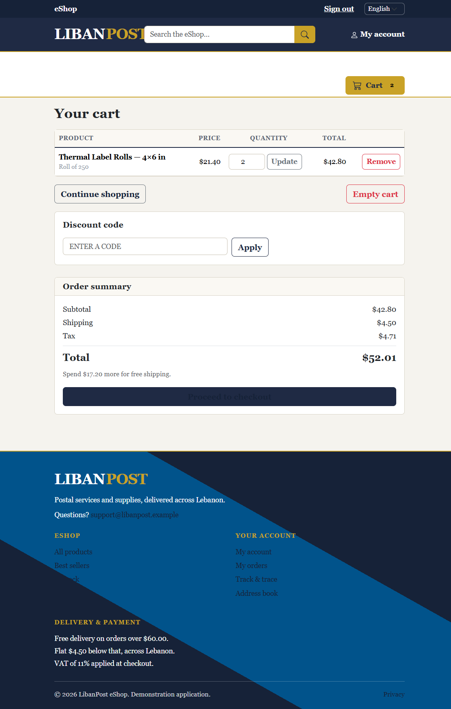

- **Quantity** per line — a number input with **Update** (POST, re-prices the line).
- **Remove** per line — POST form.
- **Discount code** — a text box plus **Apply** (POST). Codes are matched
  case-insensitively; rules (minimum spend, expiry, total/per-user limits, scope) are
  re-checked at order time, so an expired code simply stops discounting.
- **Order summary** — subtotal, shipping (free over the threshold), and **tax** computed
  from the line's tax class (11 % in this seed). "Spend $X more for free shipping" hints
  at the threshold.
- **Proceed to checkout** takes you to the checkout form.

### Checkout — `/Checkout`

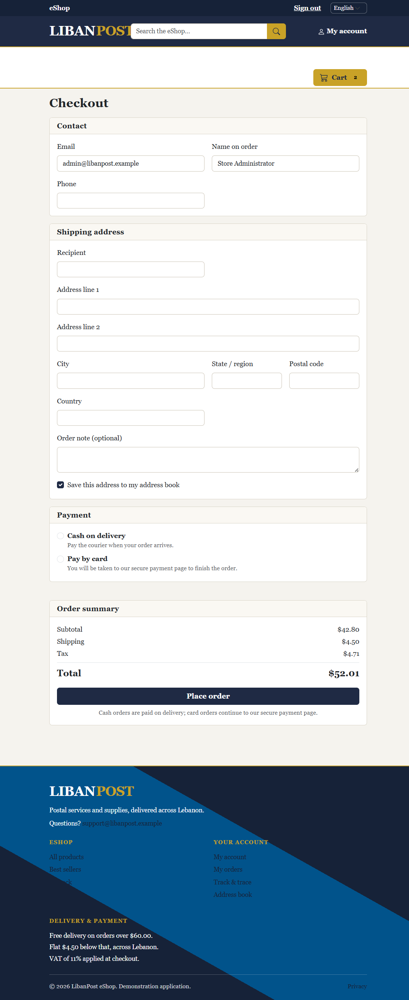

The biggest shopper form, grouped into four fieldsets:

- **Contact** — `Email` (required, valid, ≤256 chars; the receipt goes here), `Name on
  order` (required), `Phone` (optional, phone format). Both are pre-filled when you are
  signed in.
- **Shipping address** — `Recipient`, `Address line 1` (required), `Address line 2`
  (optional), `City`, `State/region`, `Postal code`, `Country` (required fields enforced
  server-side), and `Order note` (≤1000 chars, shown to staff). **Save this address to my
  address book** controls whether the address is kept for next time.
- **Payment** — radio: **Cash on delivery** (order completes as *pending payment* → paid
  on delivery) or **Pay by card** (order is created, then you are redirected to the
  provider's hosted page — in this demo, the simulator).
- **Order summary** — the same totals as the cart, including tax.
- **Place order** — an anti-double-submit hidden key prevents repeat orders on
  double-clicks.

### Payment (simulator) — `/Payments/Simulator?reference=…`

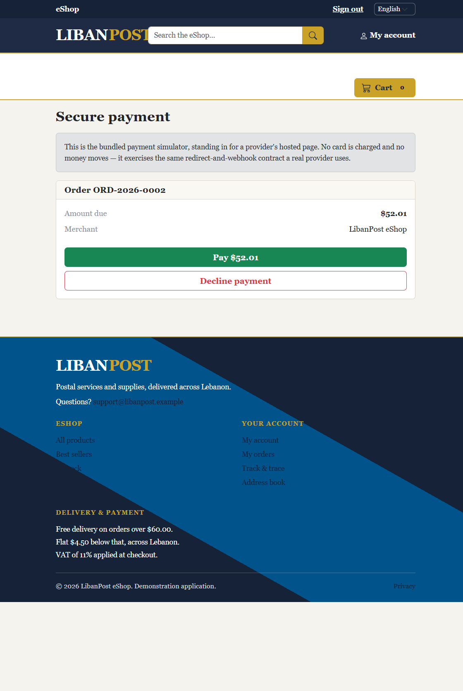

The demo stands in for a real provider's hosted page: it shows the order reference, the
amount due and the merchant, with **Pay** and **Decline payment** buttons. No card is
charged; the page exercises the same redirect-and-return contract a real gateway would.

### Payment return — `/Payments/Return/{id}`

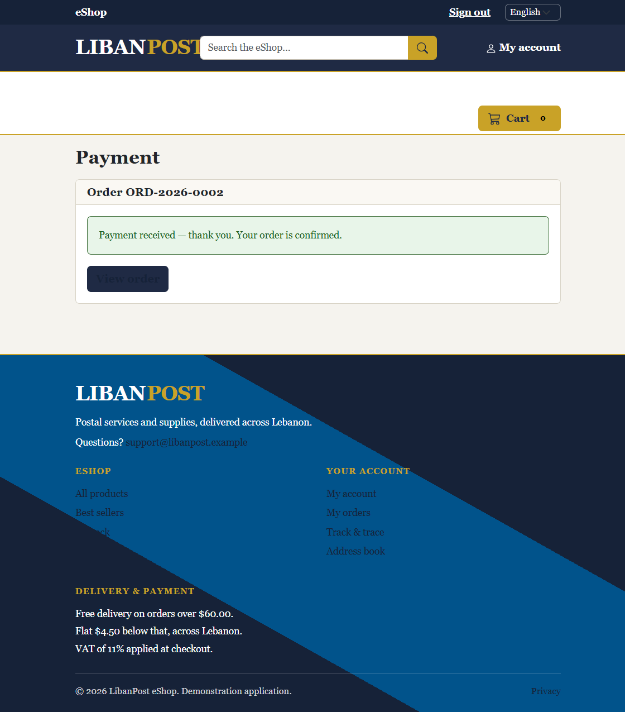

After paying you come back to the store with a success banner and a **View order** button.
A declined payment returns here with a failure message and the order stays unpaid.

### Your orders — `/Orders`

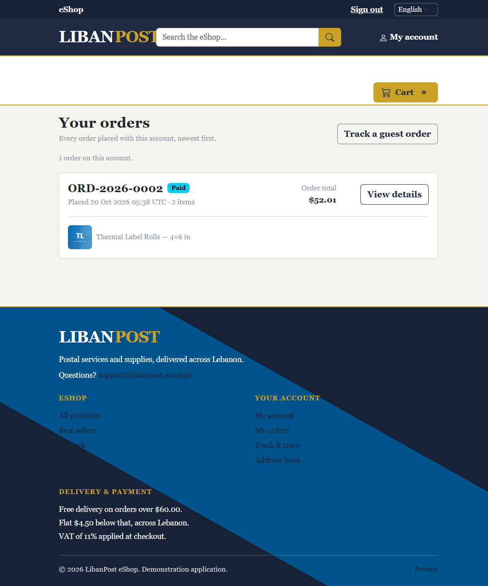

Order history cards: order number, status badge (*Paid*, *Shipped*…), placement date,
item count, total, and a thumbnail row. **View details** opens the full order.

### Order detail (customer view) — `/Orders/Details/{id}`

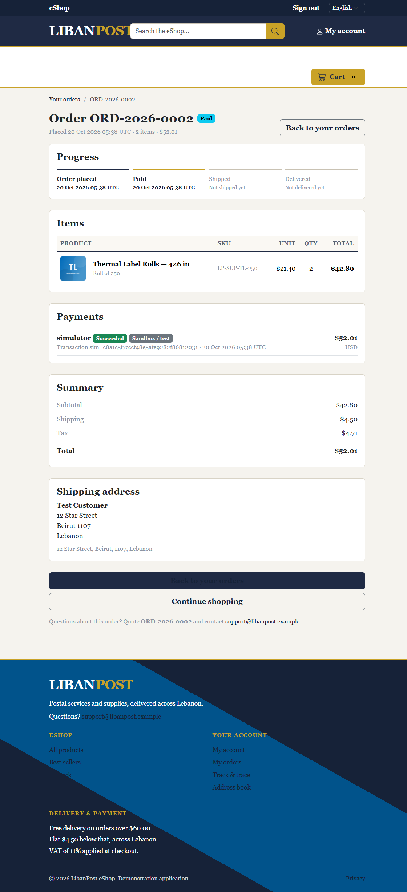

No editable forms — a read-only view with the status **progress bar** (order placed → paid
→ shipped → delivered with timestamps), item lines with SKU/qty/price, the **payments**
block (provider, status, transaction id, amount) — and the shipping address. A quote line
at the bottom tells the customer which support email to contact.

### Guest order tracking — `/Orders/Track`

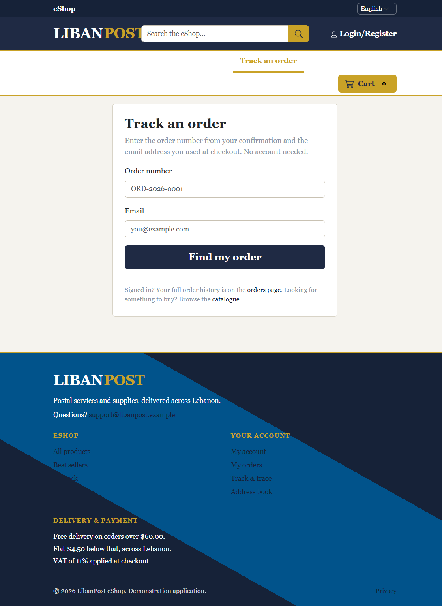

Two fields, both required: **Order number** and the **email used on the order** (must be a
valid email). A match shows the same progress view as the logged-in order history — useful
for shoppers who created no account.

### Wishlist — `/Account/Wishlist`

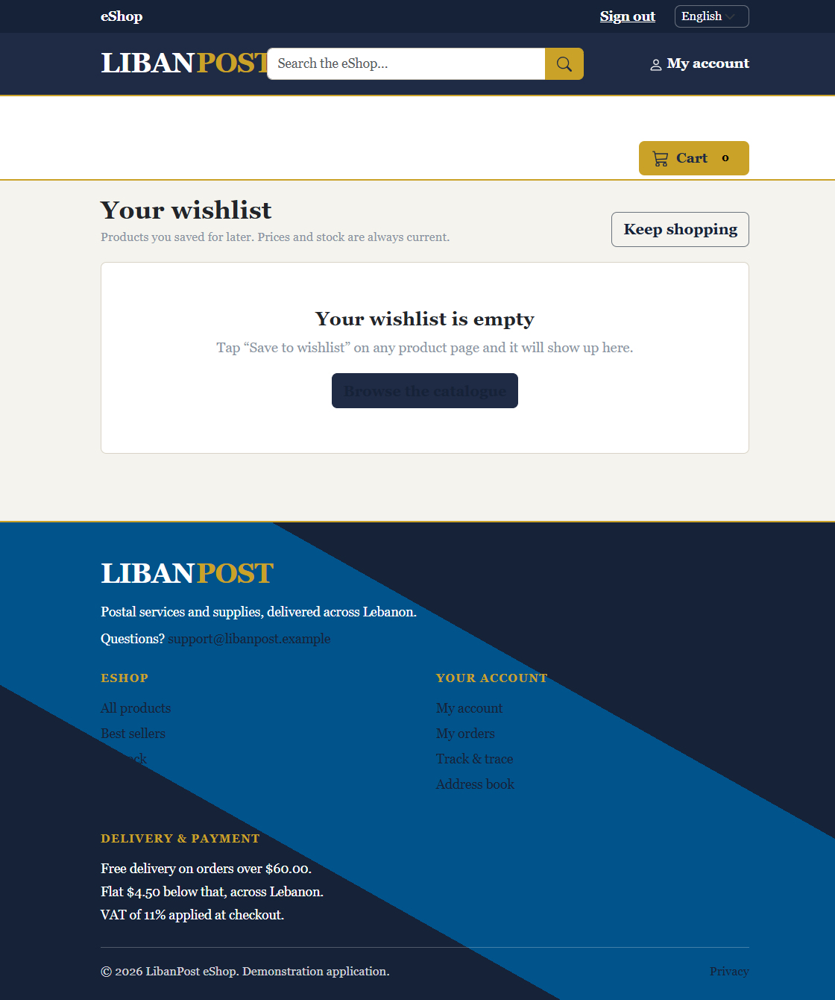

Empty state shown here: "Tap Save to wishlist on any product page". Each saved row carries
current price/stock and an add-to-cart button; entries are removed with the remove button.

---

## Part 3 — Your account

### Sign in — `/Account/Login`

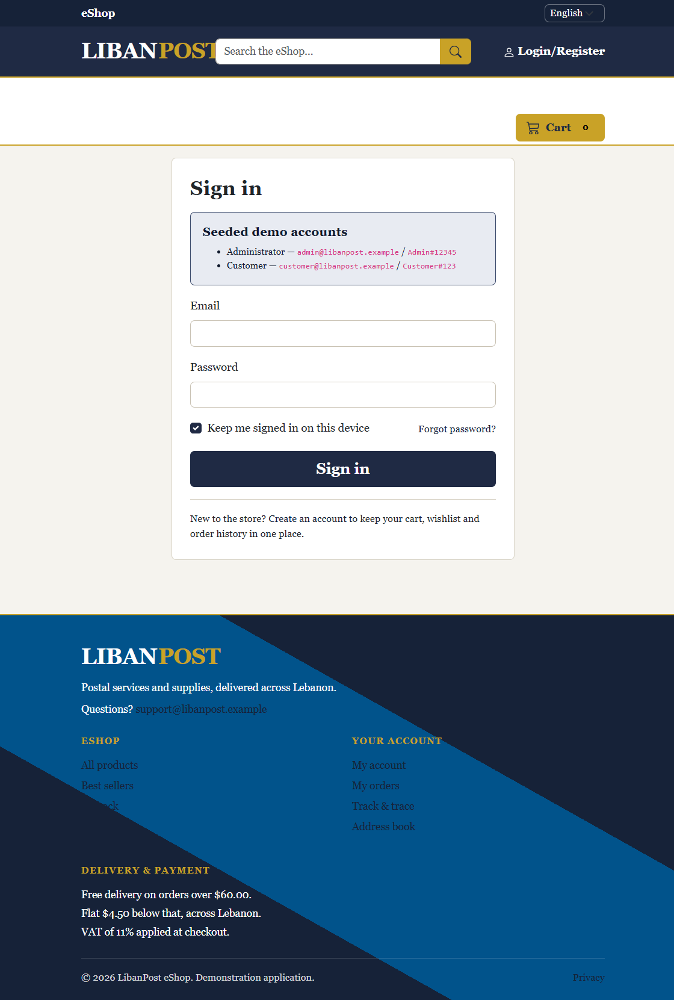

Fields: **Email** (required, valid email), **Password** (required), **Keep me signed in**
(checked by default), plus a **ReturnUrl** hidden field so redirected users land back
where they started. The demo helpfully lists the seeded accounts.

### Create an account — `/Account/Register`

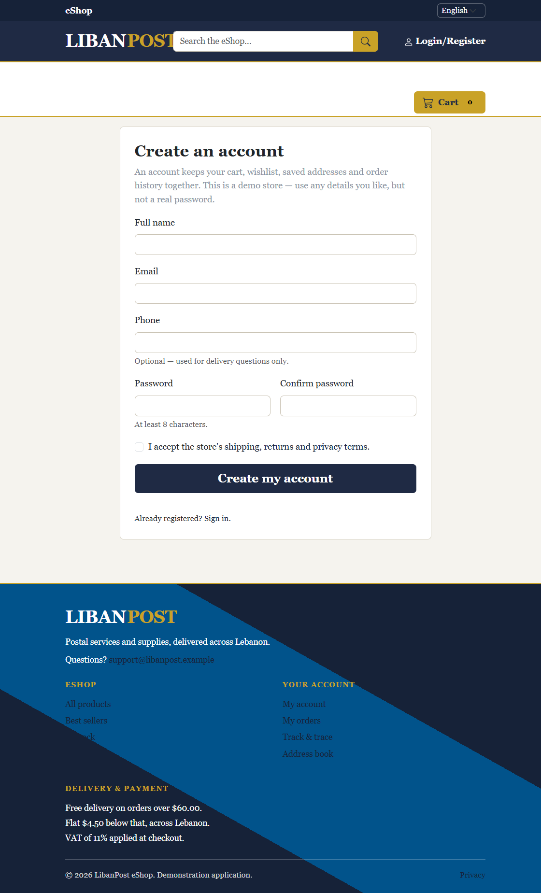

Fields: **Full name** (≤120), **Email** (unique per store), **Phone** (optional),
**Password** (8–100 chars, the same rules ASP.NET Identity enforces on the server),
**Confirm password**, and a terms acceptance checkbox before **Create account**.

### Forgot password — `/Account/ForgotPassword`

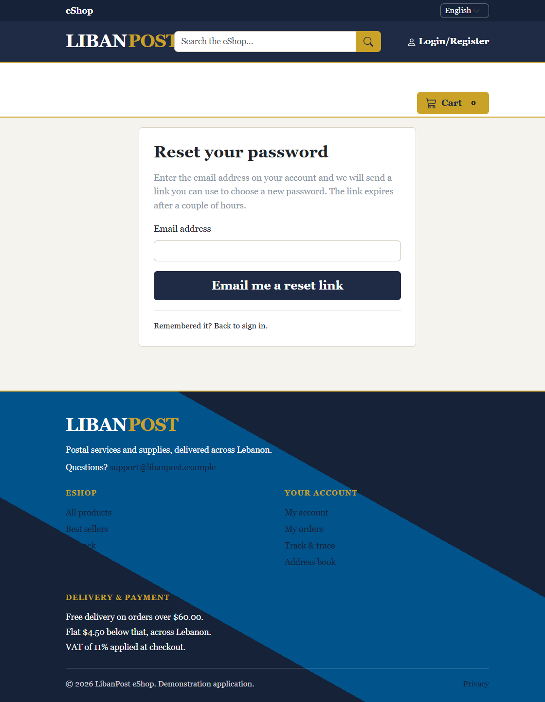

Just an **Email** field. The store never reveals whether the address exists — the response
is identical either way. With the demo email transport (`Email:Transport: File`) the reset
message is written to `App_Data/outbox` and the reset link is there.

### Profile — `/Account/Profile`

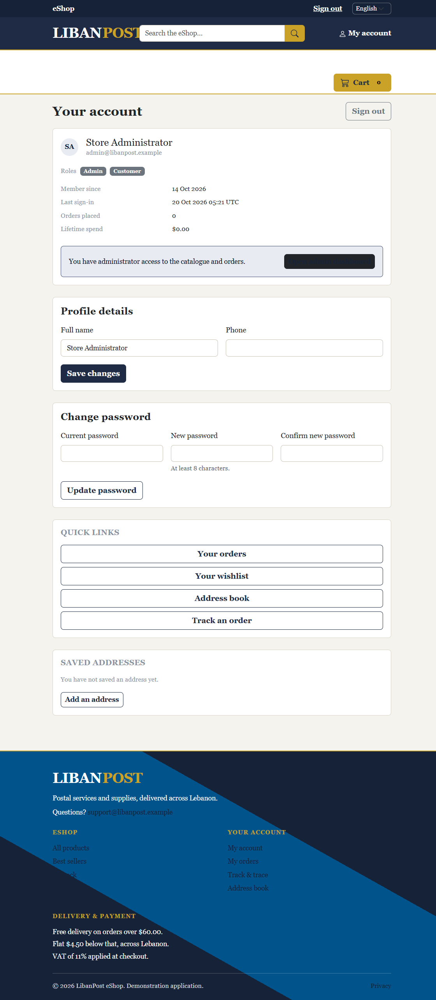

Two forms on one page:

- **Update profile** — display name (≤120) and phone (optional), prefilled from the
  account.
- **Change password** — current password (must be correct), new password (8–100), and a
  confirmation that must match.

### Address book — `/Account/Addresses`

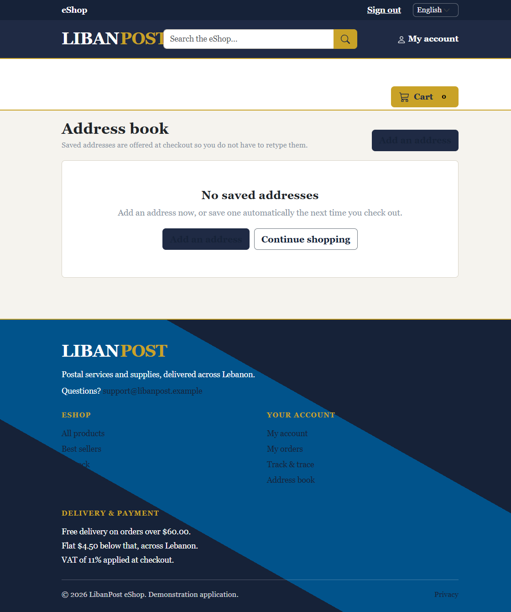

One card per saved address with **Edit**, **Delete** and **Set default** (POST forms, each
with anti-forgery token). The default badge marks the address checkout pre-selects.

### Edit an address — `/Account/EditAddress`

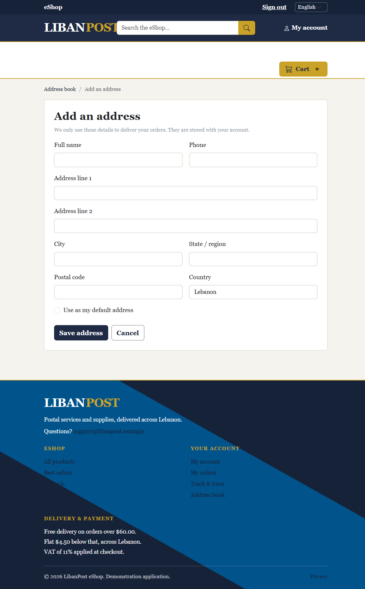

A fresh empty address (the admin demo account had none saved). All the shipping fields
from checkout reappear: full name (required), street line 1 (required), optional line 2,
city (required), optional region, postal code (required), country (required), optional
phone, and a **make this the default** checkbox.

---

## Part 4 — Store administration (`/Admin`)

Admin pages share the dark left-hand navigation; the highlight moves to the current page
and there is always a "Back to eShop" link in the header.

### Dashboard — `/Admin`

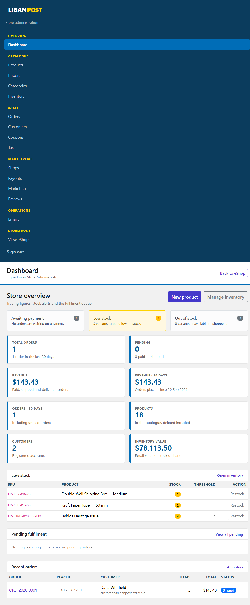

An overview: KPI tiles (revenue, orders, AOV, cancellation rate), a revenue trend strip,
the **order funnel** (placed → paid → shipped → delivered), top products, revenue by
category with bars, new customers, top customers, payment methods, coupon performance and
fast-moving variants. Each block exposes **CSV / Excel** export buttons (GET links, not
POSTs).

### Products — `/Admin/Products`

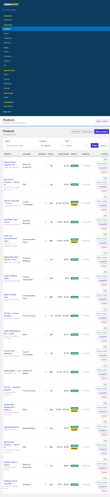

The catalogue grid: product, category, variant count, total stock, price range, status
pill (Published / Featured), updated date. Actions per row: **Edit**, **View in shop**,
**Unpublish**, **Delete** (all small POST forms; *Delete* is a soft-delete — the product
can be restored). The **search/filter** bar (product name or SKU, category dropdown, state
dropdown) is a GET form; **Export CSV / Export Excel** links reproduce the current filter.

### New product — `/Admin/Products/Create`

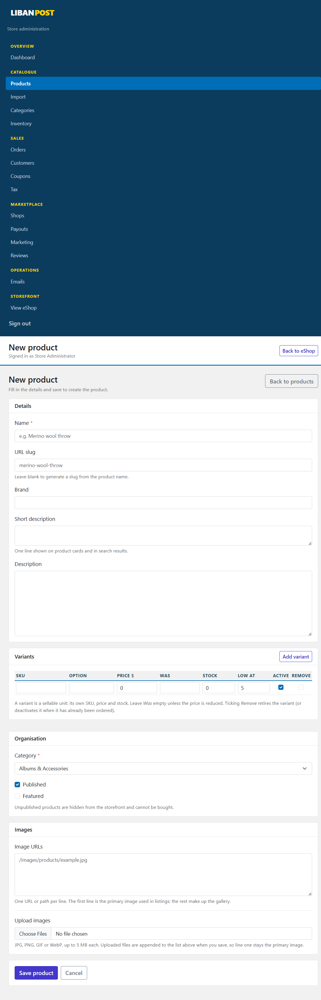

The product editor (same form as "Edit", with an empty model):

- **Details** — `Name` (required, ≤160), `URL slug` (auto-filled from the name, editable,
  must stay unique), `Brand`, `Short description` (≤200 — the card line), `Description`
  (full text).
- **Variants** — a repeating row: SKU (required, ≤64), option label (e.g. *Pack of 10*),
  `Price` (>0), `Was` (compare-at price), `Stock`, `Low at` (low-stock threshold,
  default 5), `Active`, and **Remove** (reduced to *deactivate* if it has already been
  ordered). **Add variant** clones a new empty row.
- **Organisation** — `Category` (required dropdown), **Published** and **Featured**
  checkboxes.
- **Images** — one URL/path per line (the first line is the primary image) or a file
  picker uploading JPG/PNG/GIF/WebP up to 5 MB; uploads append to the URL list on save.
- **Save product** posts everything to `/Admin/Products/Save`; invalid fields come back
  inline.

### Edit product — `/Admin/Products/Edit/1` (example)

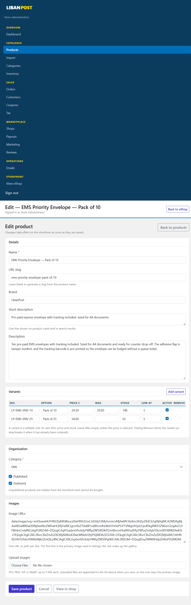

Pre-filled with the existing product *EMS Priority Envelope — Pack of 10*: two variant
rows (ENV-10 / ENV-25), attached category, published + featured, and the image list. The
image URL line shows the seeded data-URI images the demo uses. Changes go live as soon as
they are saved.

### Import products from CSV — `/Admin/Import`

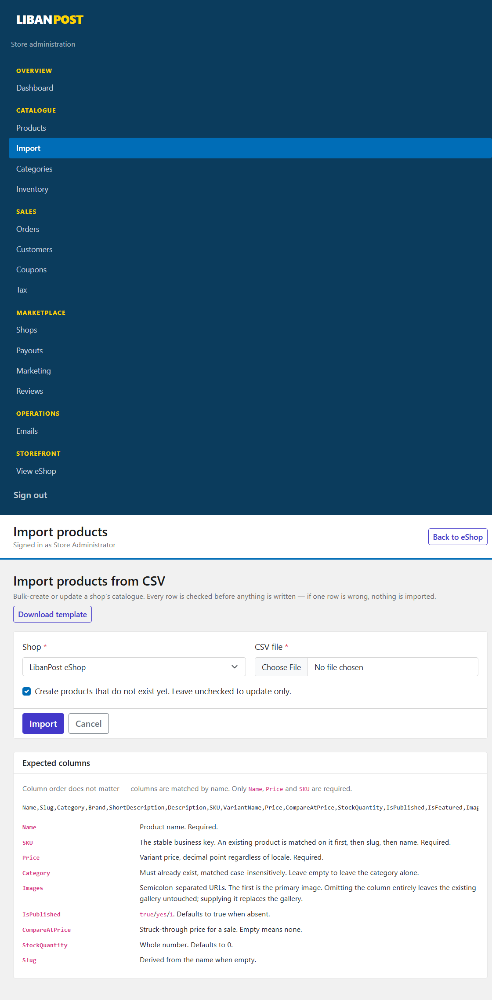

Form: **Shop** (dropdown of shops — required), **CSV file** (required; format checked and
every row validated before *anything* is written — an all-or-nothing import), and
**Create products that do not exist yet** (uncheck for update-only). **Download template**
writes the exact header row. The expected-columns table documents each field; only
`Name`, `Price` and `SKU` are required.

### Categories — `/Admin/Categories`

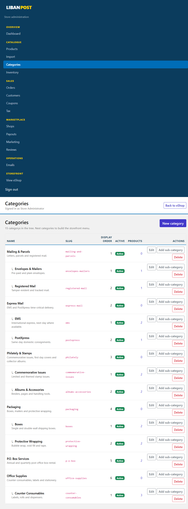

A nested tree (15 categories in the seed) with per-row **Edit**, **Add sub-category**,
**Delete** (guarded — a category with products can be hidden but not deleted), display
order and an Active pill. **New category** opens the editor.

### New / edit category — `/Admin/Categories/Create`

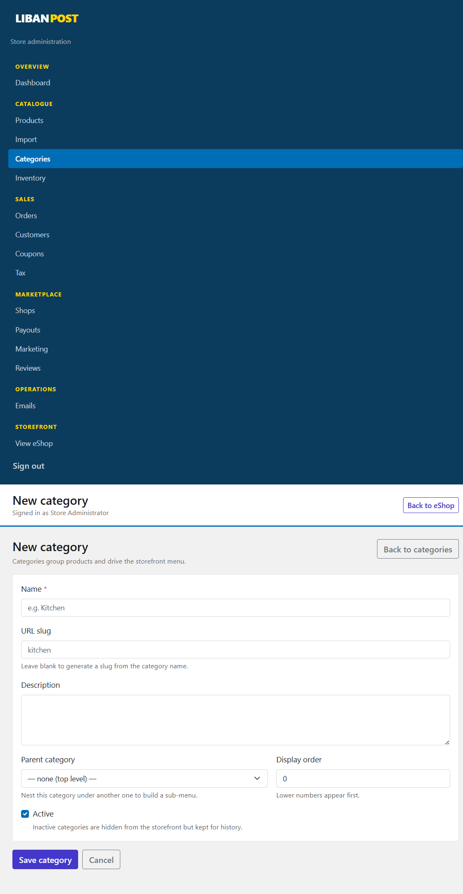

Fields: `Name` (required, ≤80), `URL slug` (auto-generated when blank), `Description`
(≤500), **Parent category** dropdown ("none (top level)"), **Display order** (lower
numbers first), **Active** checkbox. Parent cycles are prevented on save.

### Inventory — `/Admin/Inventory`

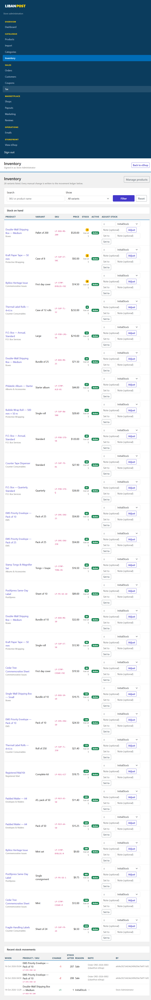

29 variants listed with stock levels (low stock highlighted in amber). Two adjustment
forms per row:

- **Adjust stock (−/+)** — `Adjust by` (signed int), optional `Note`, applying a signed
  delta; every movement is journalled.
- **Set** — a `set to` box and note to pin the absolute count.

At the bottom, **Recent stock movements** logs every change with product, delta, resulting
level, reason and who made it.

### Orders — `/Admin/Orders`

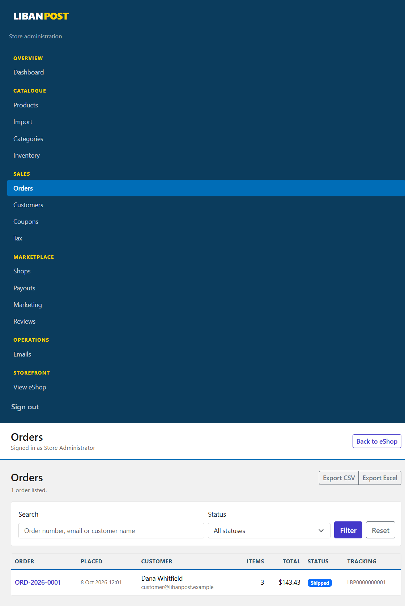

Filter bar (search — order number/email/customer; status dropdown) plus Export CSV/Excel.
Rows show order, placed, customer, items, total, status badge and tracking number. Click
the number to manage the order.

### Order detail (admin) — `/Admin/Orders/Details/{id}`

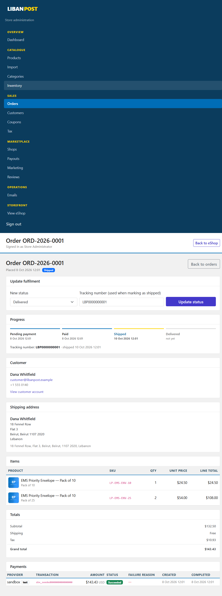

- **Update fulfilment** — `New status` dropdown (only legal transitions are offered by
  the state machine) and a `Tracking number` box used when choosing *Shipped*.
- Read-only blocks: progress timeline, customer card (link to the customer's account),
  shipping address, item lines (SKU, qty, unit price, line total), totals (subtotal,
  shipping, **tax**, grand total) and **payments** with transaction id, amount and
  status.

### Customers — `/Admin/Customers`

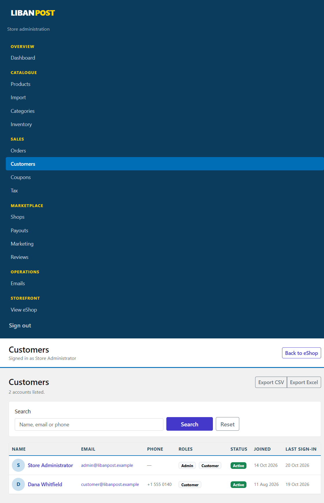

Search box plus role/status badges per account, joined and last sign-in dates, and Export
buttons. Each name links to **Details** (`/Admin/Customers/Details/{id}`) with lifetime
spend and order history; from there a customer can be deactivated/reactivated (a hidden
`isActive` POST form).

### Coupons — `/Admin/Coupons`

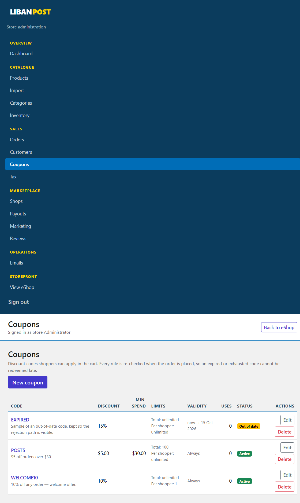

One row per code: discount (percent or amount), minimum spend, limits (total uses /
per shopper), validity window, uses so far and a status pill (the seeded `EXPIRED` code
shows *Out of date*). **Edit** opens the same form as below; **Delete** is a guarded POST.

### New coupon — `/Admin/Coupons/Create`

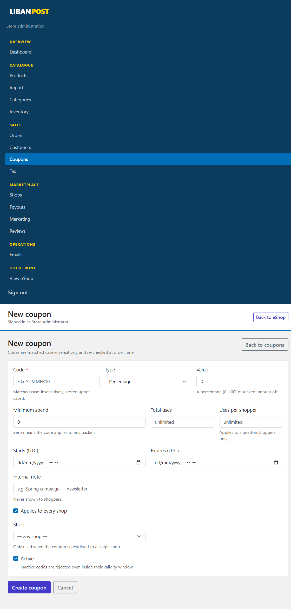

Fields: `Code` (matched case-insensitively, stored upper-cased), `Type` (Percentage / 
Fixed), `Value` (0–100 %, or an amount), `Minimum spend` (0 = any basket), `Total uses`
and `Uses per shopper` (blank = unlimited; per-shopper applies to signed-in shoppers
only), `Starts (UTC)` / `Expires (UTC)` datetime pickers (either bound may stay empty),
`Internal note` (never shopper-visible), **Applies to every shop** (uncheck to restrict to
one shop), the `Shop` dropdown used when restricted, and **Active** (inactive codes are
rejected even inside their window).

### Tax classes — `/Admin/Tax`

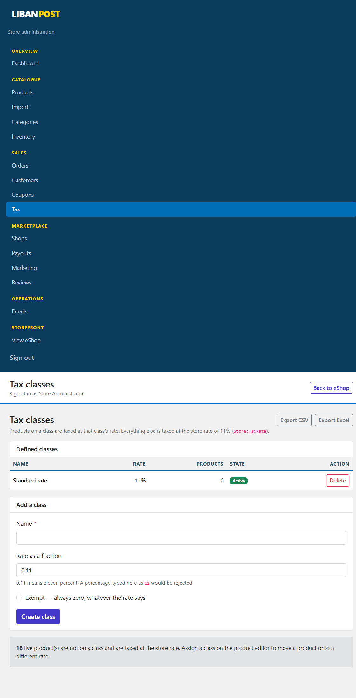

- **Defined classes** — name, rate, product count, state, and **Delete** (refuses when
  products still reference the class).
- **Add a class** — `Name` and `Rate as a fraction` (`0.11` = eleven percent; typing
  `11` is rejected) plus an **Exempt** checkbox that forces zero.
- The store rate (11 %) applies to products with no class; the warning strip counts the
  live products not on any class.

### Shops — `/Admin/Shops`

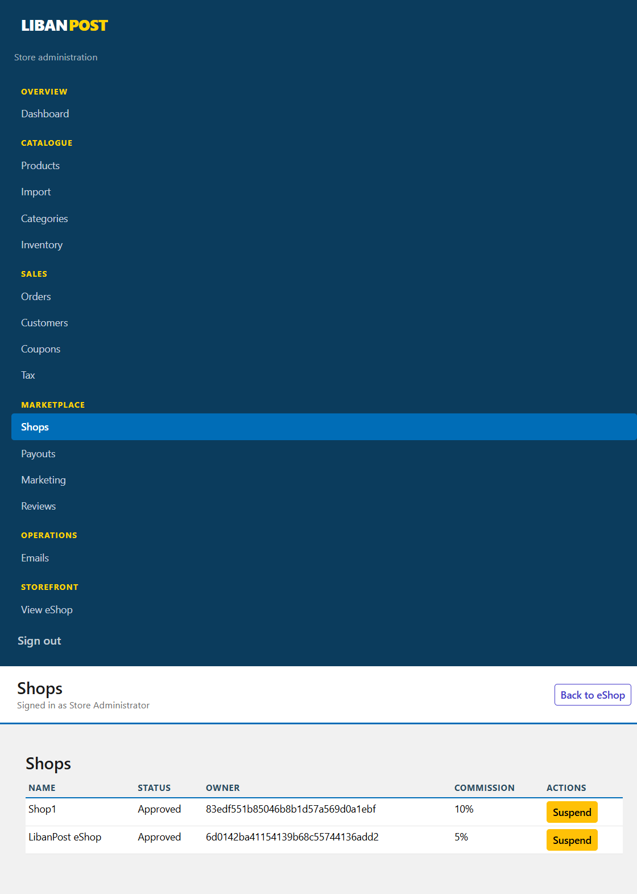

One row per shop: status, owner, and commission. From here an administrator can approve a
new vendor (setting the commission percentage) or **Suspend** a shop (a hidden reason is
recorded; suspended shops cannot sell).

### Payouts (marketplace) — `/Admin/Payouts`

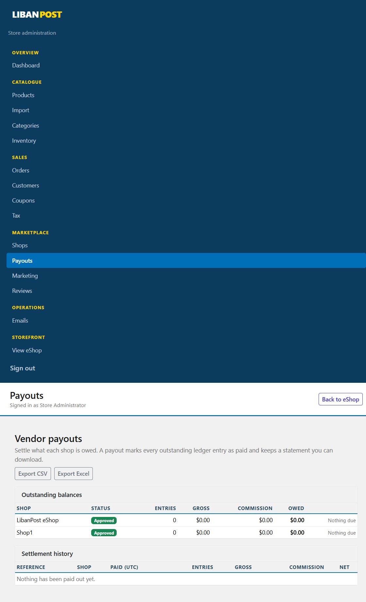

- **Outstanding balances** — per approved shop: unsettled entries, gross, commission,
  owed, and a **Create payout** form (method + note) when above the configured minimum.
- **Settlement history** — every past payout with reference, period, gross /
  commission / net, and downloadable statements.

### Marketing dashboard — `/Admin/Marketing`

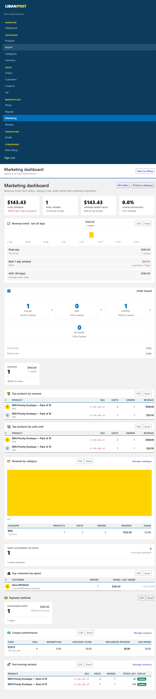

Revenue trend, order funnel, best‑selling and top‑revenue products, revenue by category,
new/active customers, top customers by spend, payment-method split, **coupon
performance** (uses, redemption rate, discount given, influenced revenue, avg order) and
fast-moving variants — each block with its own CSV/Excel export.

### Reviews moderation — `/Admin/Reviews`

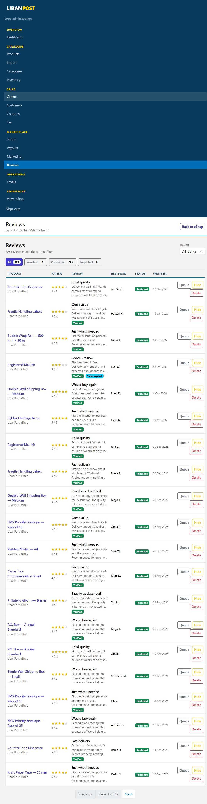

Rating filter dropdown plus status tabs (All / Pending / Published / Rejected with
counts). Each review shows product, stars, title, body, reviewer, **Verified purchase**
badge, status, and actions: **Queue → Publish/Hide** (`Set Status` POST) and **Delete**.

### Transactional email — `/Admin/Emails`

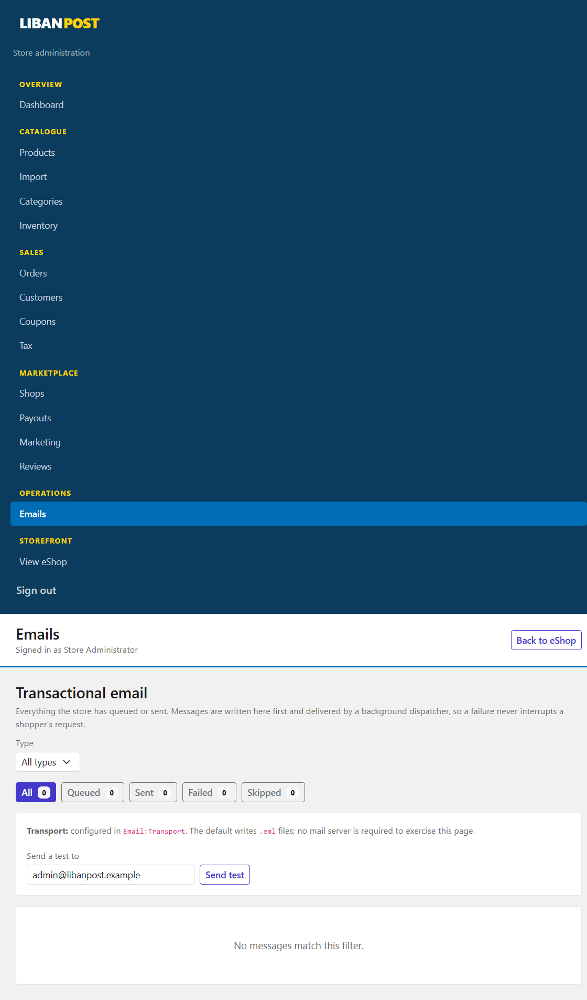

Type filter, status tabs (Queued / Sent / Failed / Skipped), the audit list of everything
the store has queued or delivered, and a **Send a test to** box that queues a test
message. With the demo *file* transport, `.eml`/`.html` copies land in `App_Data/outbox`;
switch to SMTP in `appsettings.json` to deliver for real.

---

## Part 5 — Vendor area (`/Vendor`)

Vendor pages render inside the shop's own template theme (blonde serif styling in these
captures), not the admin chrome — the seller sees their storefront identity.

### Dashboard — `/Vendor`

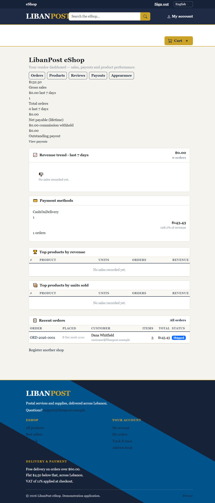

Greeting plus sales summary (gross sales, total orders, net payable, commission withheld,
outstanding payout) and **View payouts**. Blocks: revenue trend (7 days), payment-method
split (cash on delivery in this seed), top products, and **Recent orders** with status
badges. **Register another shop** is offered to vendors allowed to run multiple shops.

### Products — `/Vendor/Products`

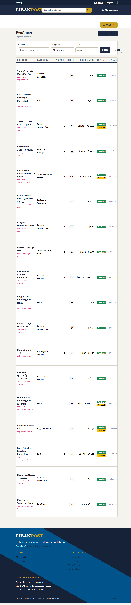

The same catalogue grid as the admin page, but every product belongs to the signed-in
shop; the same search/state filter form, publish/unpublish/edit/delete actions and stock
pillars. This is the page the *Orders* bug earlier in the project related to — vendors can
now list and manage their catalogue safely.

### New / edit product (vendor) — `/Vendor/Products/Create`

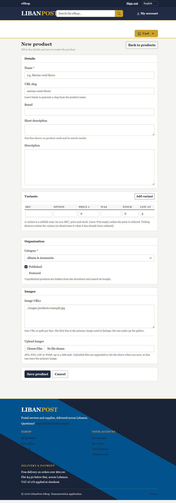

Exactly the same product editor as the admin create page (Details / Variants /
Organisation / Images), but the shop is fixed to the vendor's own and the vendor cannot
change another seller's data.

### Orders — `/Vendor/Orders`

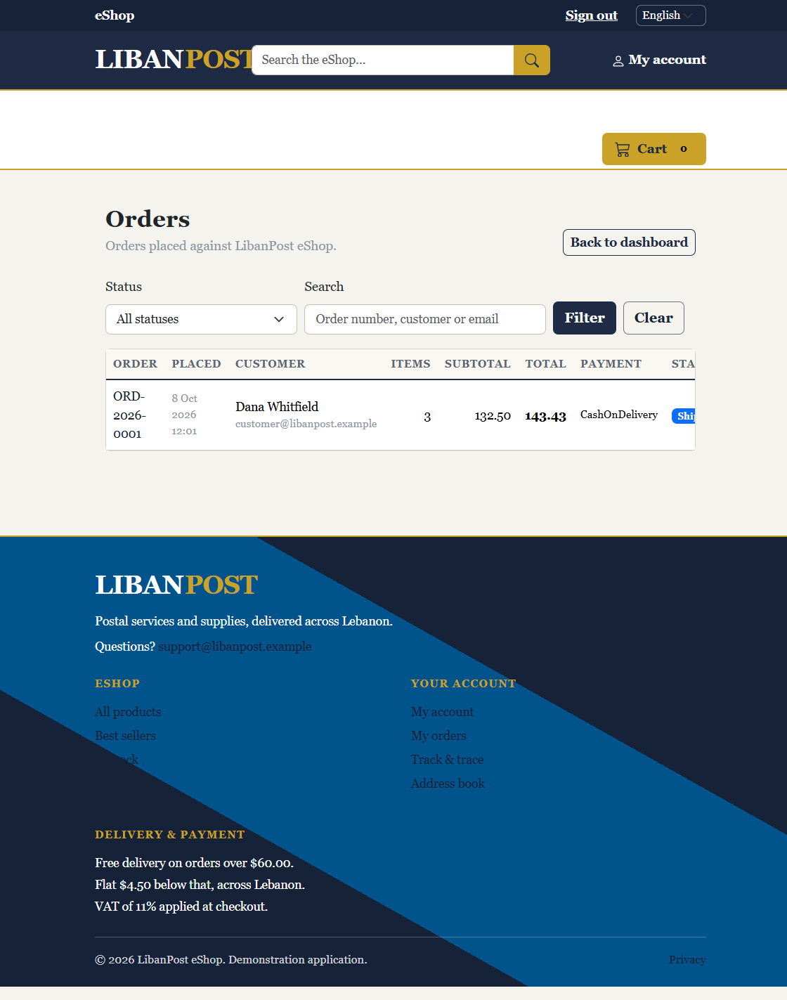

Status dropdown + search box (order number, customer, email) — one form, `GET`. The table
shows only orders containing the shop's items, with items, subtotal, total, payment method
and status. Vendors can progress their own orders (fulfil/ship) from the detail pages.

### Reviews — `/Vendor/Reviews`

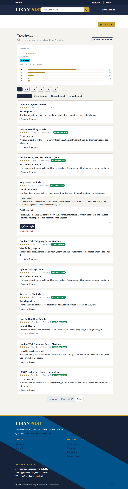

Shop rating summary (4.4★, 225 reviews, **Star seller** badge at ≥4.2) plus a rating
distribution chart and filter buttons (5★…1★, sorts). Each card shows product, stars,
date, Verified-purchase badge, and the **Your reply** block: vendors can post a public
reply, edit it, or remove it — which affects only their reply, never the customer's
review.

### Payouts (vendor) — `/Vendor/Payouts`

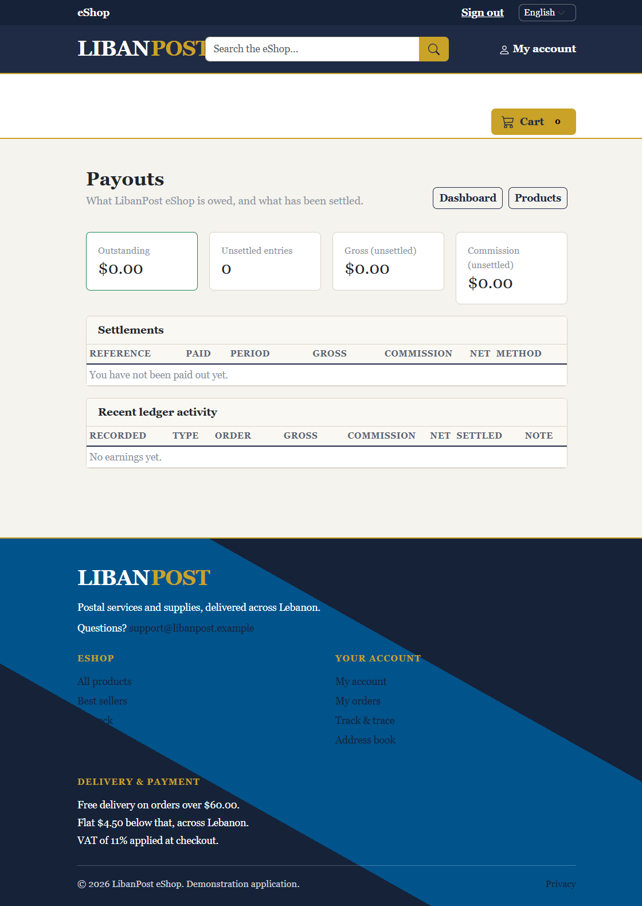

Outstanding / unsettled / gross / commission tiles, the **Settlements** table (references,
period, gross→net per payout method), and **Recent ledger activity** — the money trail the
marketplace records as orders become payable.

### Appearance — `/Vendor/Appearance`

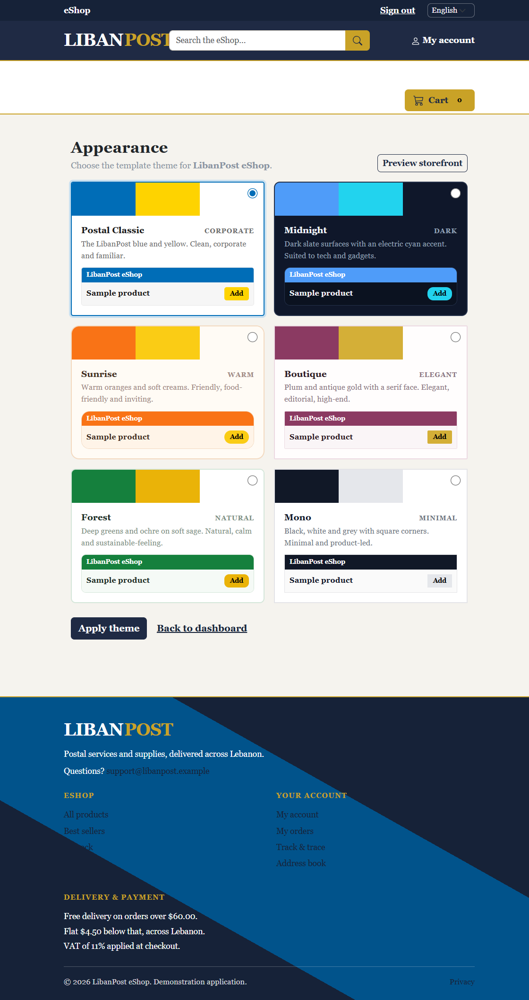

A **radio** list of six template themes (Postal Classic, Midnight, Sunrise, Boutique,
Forest, Mono), each rendered as a live mini-preview. **Apply theme** re-colours the
vendor's storefront instantly; **Preview storefront** opens it in a new tab.

### Register your shop — `/Vendor/Onboarding/Register`

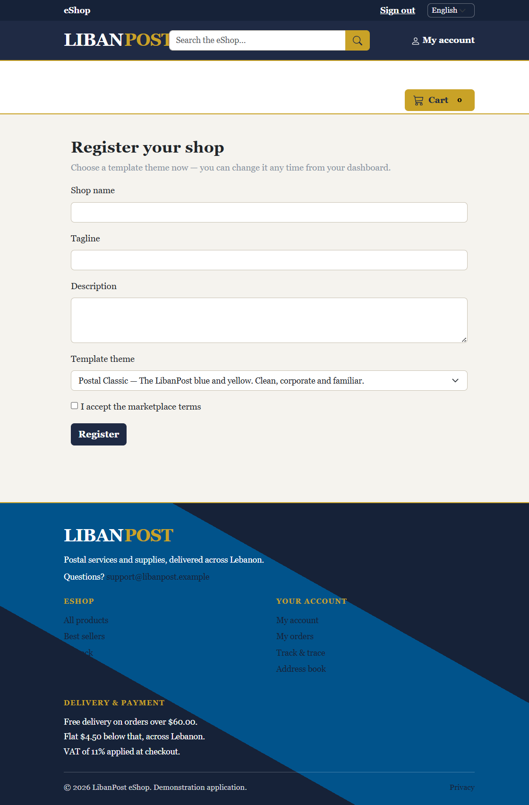

For accounts with no shop yet. Fields: `Shop name` (required), `Tagline`, `Description`,
`Template theme` (one of the six), and the terms acceptance checkbox. Optional contact
details (contact name, phone, email, address, city, postal code, pickup location —
country defaults to *Lebanon* in the model) round out the form. A new shop starts as
**pending approval**, then appears for the administrator in `/Admin/Shops`.

---

## Part 6 — Returns, refunds and the audit trail

The pages below were added with the returns (RMA) and audit-trail work. They are described in
text here; the existing 47 screenshots above cover the storefront, cart, checkout, account,
admin and vendor surfaces that did not change.

### Returns queue — `/Admin/Returns`

The marketplace's RMA desk. Filter bar (status select + free-text search on RMA reference,
shopper email or order number) above a table of requests; the counters above it show how many
sit at *requested*, *approved* and *received*. Each row links to the return detail. Export
links (CSV / Excel) honour the current filter.

### Return detail (admin) — `/Admin/Returns/Details/{id}`

The full return: shopper's request, the shop's decision and note, the line-by-line units and
values, the audit history beneath it. Depending on state, the administrator can **approve** or
**reject** (with a note), **record goods received** (restocks the shelf), or **issue the
refund** (the amount is computed — goods + proportional tax, shipping only on a full return —
and is capped by the ledger remainder and `GrandTotal − RefundedTotal`).

### Audit trail — `/Admin/Audit`

Newest-first table of administrative actions: timestamp, actor, dotted action
(`shop.approved`, `refund.failed`, `payout.reversed`, …), the subject as *entity type + id*,
and the one-sentence summary. Filter form with four fields — `actionName`, `entityType`,
`entityId`, `actor` — each with a datalist of suggestions derived from the data. Export
links (CSV / Excel, up to 500 rows).

### Request a return — `/Orders/RequestReturn/{id}`

Shopper-facing form on an eligible order: one row per order line with the quantity input capped
at the units still returnable (`max` attribute, re-checked server-side), and a `Note`
textarea (≤ 1000 chars). `OrderId` and each `OrderLineId` are hidden. An order with
nothing left to return, or already holding an open return, is refused before the form renders.

### Vendor returns — `/Vendor/Returns`

The shop's RMA worklist: `All` / `Open only` filter links, then reference, order, requested
date, units, goods value and a status badge per row, with a **Review** button into the detail.

### Vendor return detail — `/Vendor/Returns/Details/{id}`

Approve / reject (with a note the shopper sees) and **record goods received** — which restocks
the listing pool (or the shared variant stock) and writes a return-stamped movement. The refund
itself is staff-only and never appears here.

### Payout detail (admin) — `/Admin/Payouts/Details/{id}`

Read-only statement plus, while the payout is still `Paid`, two correction forms: **Mark
failed** (`reason`, required, ≤ 500 chars) and **Reverse** (`note`, optional). A failed or
reversed payout shows its reason, handler and timestamp instead.

### Shops (admin) — payout destination and history

`/Admin/Shops` now shows each shop's recorded payout destination (account name, bank, IBAN, or
"Not provided") and a **history** link to `/Admin/Audit` pre-filtered to that shop. The four
per-shop forms remain: **Approve** (`id`, `commissionPercent`), **Reject** (`id`, `reason`),
**Suspend** (`id`, `reason`), **Reinstate** (`id`).

### Payouts (vendor) — bank details and badges

`/Vendor/Payouts` now carries the **payout destination** form (`bankAccountName`,
`bankName`, `bankIban`) at the top, plus a status badge on every settlement (`Paid`,
`Failed`, `Reversed`) with the reason shown on failed/reversed rows.

### Shop registration — bank fields

`/Vendor/Onboarding/Register` now collects `BankAccountName`, `BankName` and `BankIban`
alongside the existing shop details, and a re-application pre-fills them.

---

## Where to look next

- `PAGES_AND_FORMS.md` — every route, model and field, plus Appendix C's validation rules.
- `USER_GUIDE.md`, `VENDOR_GUIDE.md`, `ADMIN_GUIDE.md` — task-oriented walkthroughs.
- `README.md` (repo root) and `docs/README.md` — the full documentation index.
